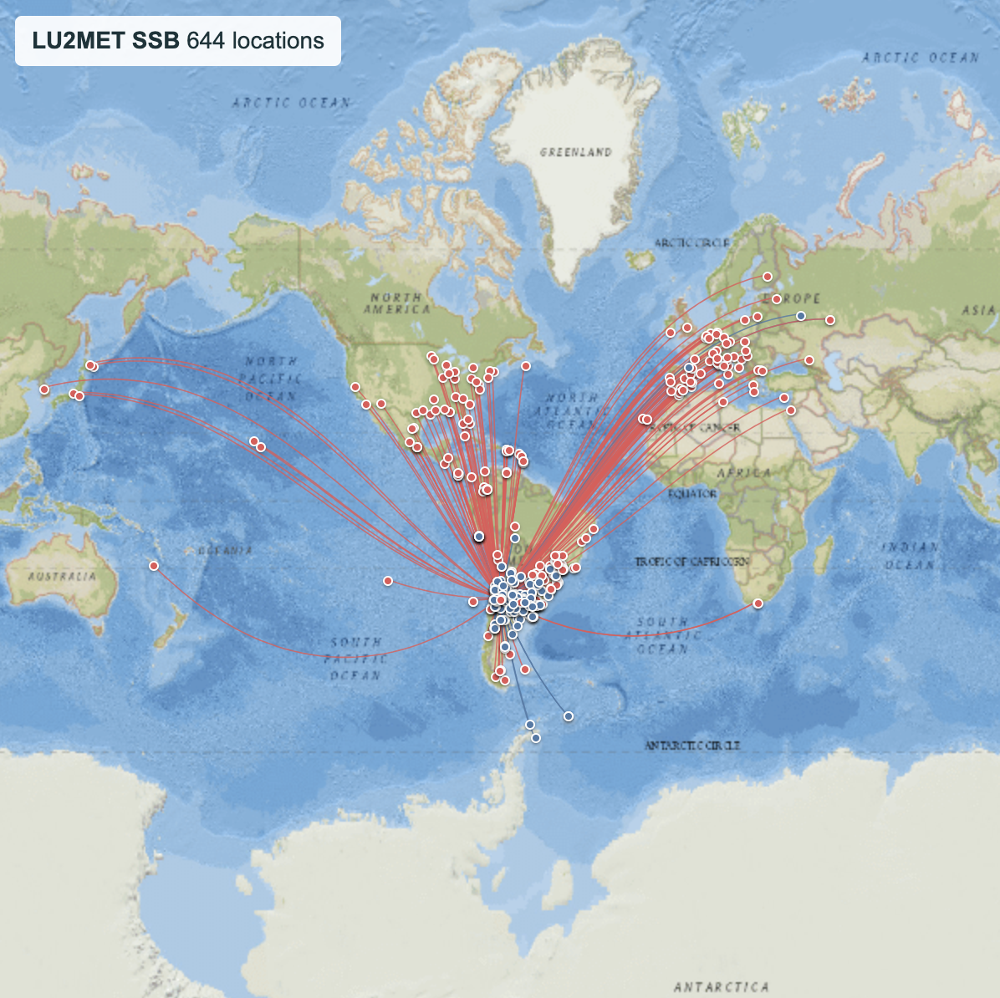
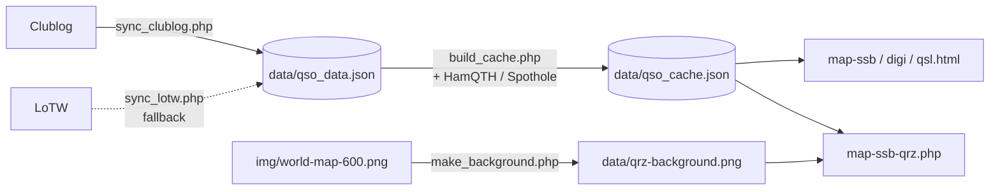

# QSO Map

A web map of an amateur radio station's contacts (QSOs). It downloads the log from **Clublog** or **LoTW**, places each contact by its Maidenhead grid and draws the great-circle path from the home QTH. Built for shared PHP hosting (cPanel): no database, no build step.

**Live demo (LU2MET):** [interactive SSB map](https://lu2met.ar/qsomap/map-ssb.html) · [static map for QRZ](https://lu2met.ar/qsomap/map-ssb-qrz.php)

[](https://lu2met.ar/qsomap/map-ssb.html)

*LU2MET static map as of 2026-10-17. Click the image to open the live interactive map.*

## Features

- **Three interactive views** (Leaflet): `map-ssb.html` (phone and CW), `map-digi.html` (digital modes) and `map-qsl.html` (confirmed QSOs).
- Markers colored by band, short-path great-circle lines, and popups with date, frequency, mode, DXCC entity and POTA/SOTA references (`SIG`/`SIG_INFO`).
- **Static map for QRZ.com** (`map-ssb-qrz.php`): 600 × 600 px, HTML + SVG rendered on the server, no JavaScript (QRZ does not allow scripts on profile pages).
- **Daily incremental sync** via Cron from Clublog, with LoTW as a fallback or as the only source. LoTW downloads follow ARRL's guidance: only new uploads and new confirmations since the last run.
- **Grid completion**: QSOs without a grid are looked up on HamQTH and Spothole; results are reused across runs.

## How it works



1. `scripts/sync_daily.sh` (Cron) downloads the QSOs into `data/qso_data.json`.
2. `scripts/build_cache.php` normalizes the data, fills in missing grids and writes `data/qso_cache.json`, the only file the maps read. It also stores the station's callsign and grid.
3. The interactive maps load the cache in the browser. `map-ssb-qrz.php` reads it on the server and projects each point onto a background generated once with the QTH centered (equirectangular longitude, Web Mercator latitude).

## Stack

PHP 7.4+ (cURL, GD) · vanilla JavaScript · Leaflet 1.9 · Bash + Cron · Apache `.htaccess`

## Project structure

```text
├── map-ssb.html, map-digi.html, map-qsl.html   Interactive views
├── map-ssb-qrz.php                             Static map for QRZ
├── js/map.js                                   Interactive map logic
├── js/dxcc.js                                  DXCC entity catalog
├── css/map.css
├── img/world-map-600.png                       Base world map for the static map
├── scripts/                                    Sync scripts (CLI, or browser with token)
│   ├── common.php                              Config, ADIF parser, grids, HTTP
│   ├── sync_clublog.php, sync_lotw.php         QSO download
│   ├── build_cache.php                         Cache + grid lookups
│   ├── make_background.php                     Static map background
│   └── sync_daily.sh                           Cron entry point
├── data/                                       Generated files (not versioned)
└── config.json.example                         Credentials template
```

## Installation

Requirements: hosting with PHP 7.4+ and the cURL and GD extensions, Apache with `.htaccess` enabled, and Cron access. SSH is not required.

1. **Upload the project** to the hosting, e.g. to `public_html/qsomap/` (any folder name works: all paths are relative).
2. **Configure credentials:** copy `config.json.example` to `config.json` and fill it in:

   | Section | Fields | Purpose |
   | --- | --- | --- |
   | `clublog` | `email`, `password` (application password), `api_key`, `callsign` | Main QSO source |
   | `lotw` | `username`, `password`, `days_back` | Fallback, or only source if you don't use Clublog |
   | `hamqth` | `username`, `password` | Optional: grid lookups |
   | `map` | `my_callsign`, `my_grid` | Your station on the maps |
   | `web` | `token` | Optional: run the scripts from a browser |

   Configure at least Clublog or LoTW. A Clublog API key can be requested at [clublog.org/need_api.php](https://clublog.org/need_api.php); LoTW only needs your website login.
3. **First sync and background.** Without SSH, set `web.token` in `config.json` and open these URLs in order, waiting for each one to finish:

   ```text
   https://your-domain.com/qsomap/scripts/sync_clublog.php?token=YOUR_TOKEN      # or sync_lotw.php
   https://your-domain.com/qsomap/scripts/build_cache.php?token=YOUR_TOKEN
   https://your-domain.com/qsomap/scripts/make_background.php?token=YOUR_TOKEN
   ```

   With a terminal: `bash scripts/sync_daily.sh && php scripts/make_background.php`.

4. **Schedule Cron** once a day:

   ```bash
   cd /home/USER/public_html/qsomap && /bin/bash scripts/sync_daily.sh
   ```

5. **Open** `https://your-domain.com/qsomap/map-ssb.html`.

The full guide (QRZ iframe, verification checklist, troubleshooting) is in [docs/DEPLOYMENT.md](docs/DEPLOYMENT.md).

## Security

- Credentials live only in `config.json`, which is git-ignored and blocked by `.htaccess`. The repository only ships `config.json.example` with placeholder values.
- The scripts in `scripts/` run from the CLI (Cron), or from a browser only with `?token=` matching `web.token`, compared in constant time (`hash_equals`). With no token configured, web access is disabled. `common.php` and `sync_daily.sh` are never reachable from the web.
- `.htaccess` denies `config.json`, the raw log (`qso_data.json`), logs, `.txt`/`.md`/`.sh` files and dotfiles, and disables directory listings.
- The only public data is what the maps display: `data/qso_cache.json` (the popup data: callsign, grid, date, frequency, mode and comment of each QSO) and the PNG background.
- All external data is escaped before being inserted into HTML, both in JavaScript and PHP.

## Credits and license

Based on the idea of [QSO Map](https://git.ianrenton.com/ian/qsomap.git) by Ian Renton (M0TRT). Libraries and services are listed in [CREDITS.md](CREDITS.md).

Licensed under the [MIT License](LICENSE).
