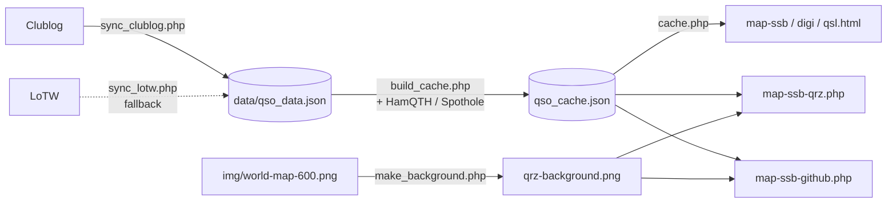

# QSO Map

A web map of an amateur radio station's contacts (QSOs). It downloads the log from **Clublog** or **LoTW**, places each contact by its Maidenhead grid and draws the great-circle path from the home QTH. One installation can serve several stations, e.g. a radio club's members. Built for shared PHP hosting (cPanel): no database, no build step.

**Live demo (LU2MET):** [interactive SSB map](https://lu2met.ar/qsomap2/map-ssb.html) · [static map for QRZ.com](https://lu2met.ar/qsomap2/map-ssb-qrz.php)

[](https://lu2met.ar/qsomap2/map-ssb.html)

*LU2MET static map, updated daily by `map-ssb-github.php`. Click the image to open the live interactive map.*

## Features

- **Three interactive views** (Leaflet): `map-ssb.html` (phone and CW), `map-digi.html` (digital modes) and `map-qsl.html` (confirmed QSOs).
- Markers colored by band, short-path great-circle lines, and popups with date, frequency, mode, DXCC entity and POTA/SOTA references (`SIG`/`SIG_INFO`).
- **Static map for QRZ.com** (`map-ssb-qrz.php`): 600 × 600 px, HTML + SVG rendered on the server, no JavaScript (QRZ does not allow scripts on profile pages).
- **Live map image for a GitHub README** (`map-ssb-github.php`): the same map as a self-contained SVG, since GitHub strips iframes but renders remote images.
- **Daily incremental sync** via Cron from Clublog, with LoTW as a fallback or as the only source. LoTW downloads follow ARRL's guidance: only new uploads and new confirmations since the last run.
- **Several stations per installation**: the same pages serve every station by callsign (`map-ssb.html?LU9XYZ`, `map-ssb-qrz.php?LU9XYZ`), each with its own settings and data; one Cron job syncs them one after the other.
- **Portals to host other stations**: the manager creates a 6-digit invite for a callsign in `admin/` (protected by cPanel's Directory Privacy); the station enters it in `join.php` with its own LoTW password (checked against LoTW, username must be the callsign), the map is set up automatically and the page hands over the QRZ.com embed code. The manager never receives anyone's password.
- **Update notice**: a daily check against this repository's version tags shows a banner, only to the map's owner, when a new version is available.
- **Grid completion**: QSOs without a grid are looked up on HamQTH and Spothole; results are reused across runs.
- **Grid check against DXCC**: grids that do not match the QSO's DXCC entity (per TQSL's grid list, with a one-square tolerance at borders) are dropped and looked up again, so contacts never show in the wrong country.

## How it works



Each station's files live in `stations/<CALL>/data/` (`qso_data.json`, `qso_cache.json`, `qrz-background.png`):

1. `scripts/sync_daily.sh` (Cron) downloads each station's QSOs into its `qso_data.json`, one station at a time.
2. `scripts/build_cache.php` normalizes the data, fills in missing grids and writes `qso_cache.json`, the only file the maps read. It also stores the station's callsign and grid.
3. The interactive maps load the cache in the browser through `cache.php?CALL`. `map-ssb-qrz.php` reads it on the server and projects each point onto a background generated once with the QTH centered (equirectangular longitude, Web Mercator latitude).

## Stack

PHP 7.4+ (cURL, GD) · vanilla JavaScript · Leaflet 1.9 · Bash + Cron · Apache `.htaccess`

## Project structure

```text
├── map-ssb.html, map-digi.html, map-qsl.html   Interactive views
├── map-ssb-qrz.php                             Static map for QRZ
├── map-ssb-github.php                          Same map as an SVG image, for GitHub
├── cache.php, background.php                   A station's map data and background, by callsign
├── join.php                                    Public portal: an invited station sets up its map
├── admin/index.php                             Manager portal: invites, stations, event log
├── js/map.js                                   Interactive map logic
├── js/dxcc.js                                  DXCC entity catalog (base list)
├── css/map.css
├── img/world-map-600.png                       Base world map for the static map
├── scripts/                                    Sync scripts (CLI, or browser with token)
│   ├── common.php                              Stations, config, invites, ADIF parser, grids, HTTP
│   ├── portal.php                              Page helpers for the two portals
│   ├── sync_clublog.php, sync_lotw.php         QSO download
│   ├── build_cache.php                         Cache + grid lookups
│   ├── make_background.php                     Static map background
│   ├── update_dxcc.php                         Monthly DXCC list refresh
│   ├── check_update.php                        Daily new-version check
│   ├── migrate_to_stations.php                 One-time upgrade from version 1
│   ├── make_world_map.py                       Rebuilds img/world-map-600.png (dev tool)
│   └── sync_daily.sh                           Cron entry point: every station, one after the other
├── stations/<CALL>/                            Each station's config.json and data/ (not versioned, never served)
├── data/                                       Shared generated files (not versioned)
├── VERSION                                     Installed version
├── config.json.example                         Manager settings template
└── docs/station-config.example.json            Station settings template
```

## Installation

Requirements: hosting with PHP 7.4+ and the cURL and GD extensions, Apache with `.htaccess` enabled, and Cron access. SSH is not required.

1. **Upload the project** to the hosting, e.g. to `public_html/qsomap/` (any folder name works: all paths are relative).
2. **Configure:** copy `config.json.example` to `config.json` and set `web.token` (to run the scripts from a browser) and `default_station` (the map shown without a callsign).
3. **Add stations:**
   - **Other stations, through the portals:** protect `admin/` with cPanel's *Directory Privacy*, create an invite there and send the code; the station does the rest in `join.php` (LoTW only).
   - **Your own station, by hand** (needed for Clublog): create `stations/YOUR_CALLSIGN/config.json` from `docs/station-config.example.json`:

     | Section | Fields | Purpose |
     | --- | --- | --- |
     | `map` | `my_callsign`, `my_grid` | The station on the maps |
     | `clublog` | `email`, `password` (application password), `api_key`, `callsign` | Main QSO source |
     | `lotw` | `username`, `password`, `days_back` | Fallback, or only source without Clublog |
     | `hamqth` | `username`, `password` | Optional: grid lookups |

     Then run its first sync and background: `bash scripts/sync_daily.sh YOUR_CALLSIGN && QSOMAP_STATION=YOUR_CALLSIGN php scripts/make_background.php`, or open the scripts in a browser with `?token=YOUR_TOKEN&station=YOUR_CALLSIGN` ([details](docs/DEPLOYMENT.md#3-first-sync-of-a-station-you-set-up-by-hand)).

4. **Schedule Cron** once a day:

   ```bash
   cd /home/USER/public_html/qsomap && PHP_BIN=/opt/cpanel/ea-php74/root/usr/bin/php /bin/bash scripts/sync_daily.sh
   ```

   `PHP_BIN` must be a PHP **CLI** binary: on cPanel the default `php` is often the CGI build, and the sync then stops with `is not a PHP CLI binary` in `data/sync.log`. [docs/DEPLOYMENT.md](docs/DEPLOYMENT.md#choosing-the-php-binary) shows how to find the right path without a terminal.

5. **Open** `https://your-domain.com/qsomap/map-ssb.html?YOUR_CALLSIGN`.

Upgrading from version 1 (one station per installation)? Upload the new files keeping `config.json` and `data/`; the next sync moves your station to `stations/` and keeps your URLs working ([details](docs/DEPLOYMENT.md#upgrading-from-version-1-one-station-per-installation)).

The full guide (portals, QRZ iframe, GitHub README image, verification checklist, troubleshooting) is in [docs/DEPLOYMENT.md](docs/DEPLOYMENT.md).

## Security

- Credentials live only in each station's `stations/<CALL>/config.json`, git-ignored and never served (`stations/.htaccess` plus a rule in the root `.htaccess`). No credential is shared between stations. The repository only ships templates with placeholder values.
- The admin portal relies on the web server's password protection (cPanel *Directory Privacy*) and refuses to work without it; its forms carry a CSRF token. Invites are a 6-digit code bound to one callsign, stored hashed, valid 48 hours, one use, cancelled after 5 failed attempts; the LoTW username must be the callsign and is checked against LoTW. Every invite, failed attempt and station change is logged to `data/events.log`, without secrets.
- The scripts in `scripts/` run from the CLI (Cron), or from a browser only with `?token=` matching `web.token`, compared in constant time (`hash_equals`). With no token configured, web access is disabled. `common.php` and `sync_daily.sh` are never reachable from the web.
- `.htaccess` denies `config.json`, `invites.json`, the raw log (`qso_data.json`), logs, `.txt`/`.md`/`.sh` files and dotfiles, and disables directory listings.
- The only public data is what the maps display: each station's map cache through `cache.php` (the popup data: callsign, grid, date, frequency, mode and comment of each QSO) and its PNG background through `background.php`, plus `data/dxcc.json` and `data/vuccgrids.json` (public DXCC lists), `data/update.json` and `VERSION` (installed and latest version).
- All external data is escaped before being inserted into HTML, both in JavaScript and PHP.

## Credits and license

Based on the idea of [QSO Map](https://git.ianrenton.com/ian/qsomap.git) by Ian Renton (M0TRT). Libraries and services are listed in [CREDITS.md](CREDITS.md).

Licensed under the [MIT License](LICENSE).
