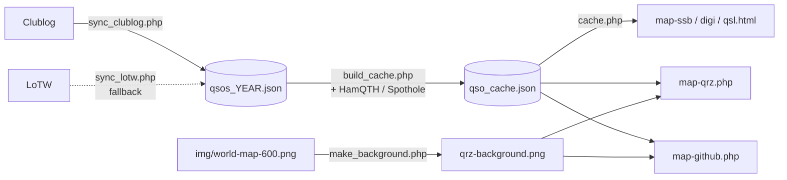

# QSO Map

A web map of an amateur radio station's contacts (QSOs). It downloads the log from **Clublog** or **LoTW**, places each contact by its Maidenhead grid and draws the great-circle path from the home QTH. One installation can serve several stations, e.g. a radio club's members. Built for shared PHP hosting (cPanel): no database, no build step.

**Live demo (LU2MET):** [interactive SSB map](https://lu2met.ar/qsomap/map-ssb.html) · [static map for QRZ.com](https://lu2met.ar/qsomap/map-qrz.php)

[](https://lu2met.ar/qsomap/map-ssb.html)

*LU2MET static map, updated daily by `map-github.php`. Click the image to open the live interactive map.*

## Features

- **Six interactive views** (Leaflet): one per mode, `map-ssb.html` (phone: SSB, AM, FM), `map-cw.html`, `map-rtty.html`, `map-ft.html` (FT8 and FT4) and `map-qsl.html` (confirmed QSOs in any mode), plus `map-dxcc.html`, one point per confirmed DXCC entity with its first confirmed QSO (date and band). Other modes (PSK, JT65...) appear only on the QSL map once confirmed. The old `map-digi.html` redirects to `map-ft.html`.
- Markers colored by band, short-path great-circle lines, and popups with date, frequency, mode, DXCC entity and POTA/SOTA references (`SIG`/`SIG_INFO`). Popups stay inside the map: near the top edge they open below their point, and very long ones scroll.
- **Big logs**: a log of more than 10,000 QSOs is shown grouped by 4-character grid square (one point per square, sized by its QSOs, with its QSOs per band, DXCC entities and latest callsigns), so maps of 100,000+ QSOs stay light; the map says so.
- **Static map for QRZ.com** (`map-qrz.php`): 600 × 600 px, showing one view chosen per station (SSB by default, or CW, RTTY, FT8/FT4 or confirmed QSOs), with its name and number of locations; HTML + SVG rendered on the server, no JavaScript (QRZ does not allow scripts on profile pages).
- **Live map image for a GitHub README** (`map-github.php`): the same map as a self-contained SVG, since GitHub strips iframes but renders remote images.
- **Daily incremental sync** via Cron from Clublog, with LoTW as a fallback or as the only source. LoTW downloads follow ARRL's guidance: only new uploads and new confirmations since the last run. The first LoTW download goes in parts by QSO date that resume where they stopped, confirmations first, so the ranking is complete within minutes even for logs of tens of thousands of QSOs.
- **Several stations per installation**: the same pages serve every station by callsign (`map-ssb.html?LU9XYZ`, `map-qrz.php?LU9XYZ`), each with its own settings and data; one Cron job syncs them one after the other.
- **Club ranking** (`ranking.php`): DXCC entities confirmed in LoTW per member as a plain table: all modes together (as DXCC Mixed), one mode (Phone, CW, RTTY, FT8/FT4) or a table per mode, filtered by mode and band from two menus that only offer what the members have confirmed. Every confirmed QSO counts, whatever its grid; positions count current entities, and confirmed deleted ones are shown as `(+N*)` with a footnote. Each callsign opens that member's interactive map of the mode. English or Spanish, embeddable with an iframe (QRZ.com, a blog, any site); the manager turns it on, sets its title and leaves members out in `admin/`.
- **Portals to host other stations**: the manager creates a 6-digit invite for a callsign in `admin/` (protected by cPanel's Directory Privacy); the station enters it in `join.php` with its own LoTW password and the mode of its static map (checked against LoTW, username must be the callsign); its whole LoTW log is downloaded, the map is set up automatically and the page hands over the QRZ.com embed code. The manager never receives anyone's password.
- **Update notice**: a daily check against this repository's version tags shows a banner, only to the map's owner, when a new version is available.
- **Grid completion**: a QSO without a grid takes the one logged for the same callsign in another QSO; otherwise the callsign is looked up on HamQTH and Spothole, once per callsign. Results are kept across runs, and callsigns not found are tried again after 30 days.
- **Grid check against DXCC**: grids that do not match the QSO's DXCC entity (per TQSL's grid list, with a one-square tolerance at borders) are dropped and looked up again, so contacts never show in the wrong country.

## How it works



Each station's files live in `stations/<CALL>/data/` (its log in `qsos_<YEAR>.json`, `qso_cache.json`, `grid_lookups.json`, `qrz-background.png`, plus the LoTW sync state and the ranking's confirmations):

1. `scripts/sync_daily.sh` (Cron) downloads each station's QSOs into its log, one station at a time. The log is kept in one file per year of QSO date, so the scripts load one year at a time and the memory they need depends on the busiest year, not on the size of the whole log.
2. `scripts/build_cache.php` normalizes the data, fills in missing grids and writes `qso_cache.json`, the only file the maps read: one entry per QSO, or one per grid square, band and mode for logs of more than 10,000 QSOs. It also stores the station's callsign and grid.
3. The interactive maps load the cache in the browser through `cache.php?CALL`. `map-qrz.php` reads it on the server, keeps the QSOs of the station's static view and projects each point onto a background generated once with the QTH centered (equirectangular longitude, Web Mercator latitude).

## Stack

PHP 7.4+ (cURL, GD) · vanilla JavaScript · Leaflet 1.9 · Bash + Cron · Apache `.htaccess`

## Project structure

```text
├── map-ssb/cw/rtty/ft/qsl.html                 Interactive views (map-digi.html redirects to map-ft.html)
├── map-qrz.php                                 Static map for QRZ (map-ssb-qrz.php: old URL, still works)
├── map-github.php                              Same map as an SVG image, for GitHub (old: map-ssb-github.php)
├── map.php                                     Redirects to the interactive view of a station's static map mode
├── ranking.php                                 Club ranking of DXCC entities confirmed in LoTW (iframe)
├── cache.php, background.php                   A station's map data and background, by callsign
├── join.php                                    Public portal: an invited station sets up its map
├── admin/index.php                             Manager portal: invites, stations, static map mode, event log
├── js/map.js                                   Interactive map logic
├── js/dxcc.js                                  DXCC entity catalog (base list)
├── css/map.css
├── img/world-map-600.png                       Base world map for the static map
├── scripts/                                    Sync scripts (CLI, or browser with token)
│   ├── common.php                              Stations, config, invites, ADIF parser, grids, HTTP
│   ├── portal.php                              Page helpers for the two portals
│   ├── static_map.php                          Shared data and projection of the static maps
│   ├── ranking_data.php                        Club ranking: LoTW confirmations, entity counts, settings
│   ├── sync_clublog.php, sync_lotw.php         QSO download
│   ├── build_cache.php                         Cache + grid lookups
│   ├── make_background.php                     Static map background
│   ├── update_dxcc.php                         Monthly DXCC list refresh
│   ├── check_update.php                        Daily new-version check
│   ├── migrate_to_stations.php                 One-time upgrade from version 1
│   ├── make_world_map.py                       Rebuilds img/world-map-600.png (dev tool)
│   └── sync_daily.sh                           Cron entry point: every station, one after the other
├── stations/<CALL>/                            Each station's config.json and data/ (not versioned, never served)
├── data/                                       Shared generated files (not versioned)
├── VERSION                                     Installed version
├── config.json.example                         Manager settings template
└── docs/station-config.example.json            Station settings template
```

## Installation

Requirements: hosting with PHP 7.4+ and the cURL and GD extensions, Apache with `.htaccess` enabled, and Cron access. SSH is not required. The sync scripts raise PHP's memory limit to 512M for big logs; since they load one year of the log at a time, a log of 70,000 QSOs needs well under the 128M most hosts default to (see [Big logs](docs/DEPLOYMENT.md#big-logs)).

1. **Upload the project** to the hosting, e.g. to `public_html/qsomap/` (any folder name works: all paths are relative).
2. **Configure:** copy `config.json.example` to `config.json` and set `web.token` (to run the scripts from a browser) and `default_station` (the map shown without a callsign).
3. **Add stations:**
   - **Other stations, through the portals:** protect `admin/` with cPanel's *Directory Privacy*, create an invite there and send the code; the station does the rest in `join.php` (LoTW only).
   - **Your own station, by hand** (needed for Clublog): create `stations/YOUR_CALLSIGN/config.json` from `docs/station-config.example.json`:

     | Section | Fields | Purpose |
     | --- | --- | --- |
     | `map` | `my_callsign`, `my_grid` | The station on the maps |
     | `clublog` | `email`, `password` (application password), `api_key`, `callsign` | Main QSO source |
     | `lotw` | `username`, `password` | Fallback, or only source without Clublog; always the source of the club ranking |
     | `ranking` | `opt_out` | Optional: leave the station out of the club ranking (also in `admin/`) |
     | `hamqth` | `username`, `password` | Optional: grid lookups |

     Then run its first sync and background: `bash scripts/sync_daily.sh YOUR_CALLSIGN && QSOMAP_STATION=YOUR_CALLSIGN php scripts/make_background.php`, or open the scripts in a browser with `?token=YOUR_TOKEN&station=YOUR_CALLSIGN` ([details](docs/DEPLOYMENT.md#3-first-sync-of-a-station-you-set-up-by-hand)).

4. **Schedule Cron** once a day:

   ```bash
   cd /home/USER/public_html/qsomap && PHP_BIN=/opt/cpanel/ea-php74/root/usr/bin/php /bin/bash scripts/sync_daily.sh
   ```

   `PHP_BIN` must be a PHP **CLI** binary: on cPanel the default `php` is often the CGI build, and the sync then stops with `is not a PHP CLI binary` in `data/sync.log`. [docs/DEPLOYMENT.md](docs/DEPLOYMENT.md#choosing-the-php-binary) shows how to find the right path without a terminal.

5. **Open** `https://your-domain.com/qsomap/map-ssb.html?YOUR_CALLSIGN`.

Upgrading to 2.6.0? Upload the new files: the DXCC map of each station appears after its next nightly sync, with nothing to download again ([details](docs/DEPLOYMENT.md#upgrading-to-260-dxcc-map)).

Upgrading to 2.5.0? Each station downloads its whole log once more on its next sync, into the new files by year; its map and ranking stay as they are until that ends ([details](docs/DEPLOYMENT.md#upgrading-to-250-log-by-year)).

Upgrading from version 1 (one station per installation)? Upload the new files keeping `config.json` and `data/`; the next sync moves your station to `stations/` and keeps your URLs working ([details](docs/DEPLOYMENT.md#upgrading-from-version-1-one-station-per-installation)).

The full guide (portals, QRZ iframe, GitHub README image, verification checklist, troubleshooting) is in [docs/DEPLOYMENT.md](docs/DEPLOYMENT.md).

## Security

- Credentials live only in each station's `stations/<CALL>/config.json`, git-ignored and never served (`stations/.htaccess` plus a rule in the root `.htaccess`). No credential is shared between stations. The repository only ships templates with placeholder values.
- Optionally (`storage` in `config.json`), the station folders live outside `public_html` and their passwords are encrypted (AES-256-GCM), with the key in a file outside `public_html`. This protects against leaked copies of the configs (a lost `.htaccess`, a commit, a backup of the site), not against someone in control of the hosting account, since the sync must be able to decrypt them ([details](docs/DEPLOYMENT.md#protecting-stored-passwords)).
- The admin portal relies on the web server's password protection (cPanel *Directory Privacy*) and refuses to work without it; its forms carry a CSRF token. Invites are a 6-digit code bound to one callsign, stored hashed, valid 48 hours, one use, cancelled after 5 failed attempts; the LoTW username must be the callsign and is checked against LoTW. Every invite, failed attempt and station change is logged to `data/events.log`, without secrets.
- The scripts in `scripts/` run from the CLI (Cron), or from a browser only with `?token=` matching `web.token`, compared in constant time (`hash_equals`). With no token configured, web access is disabled. `common.php` and `sync_daily.sh` are never reachable from the web.
- `.htaccess` denies `config.json`, `invites.json`, the raw log (`qsos_<YEAR>.json`), logs, `.txt`/`.md`/`.sh` files and dotfiles, and disables directory listings.
- The only public data is what the maps display: each station's map cache through `cache.php` (the popup data: callsign, grid, date, frequency, mode and comment of each QSO; for logs grouped by grid square, the QSO counts per square, band and mode, the DXCC entities and the latest callsigns) and its PNG background through `background.php`, plus `data/dxcc.json` and `data/vuccgrids.json` (public DXCC lists), `data/update.json` and `VERSION` (installed and latest version).
- All external data is escaped before being inserted into HTML, both in JavaScript and PHP.

## Acknowledgements

Special thanks to [LU3MC](https://www.qrz.com/db/LU3MC), [LU5MMM](https://www.qrz.com/db/LU5MMM) and [LW6EQG](https://www.qrz.com/db/LW6EQG) for lending their QSOs to test the ranking system and the map generation.

## Credits and license

Based on the idea of [QSO Map](https://git.ianrenton.com/ian/qsomap.git) by Ian Renton (M0TRT). Libraries and services are listed in [CREDITS.md](CREDITS.md).

Licensed under the [MIT License](LICENSE).
